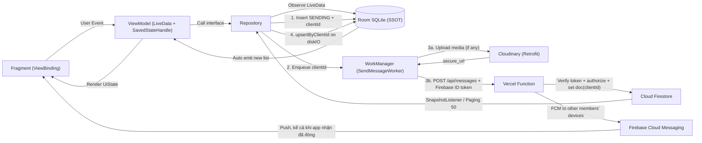

# SPEC.md — Đặc tả Kỹ thuật Tổng thể: Ứng dụng Chat Android

> **Tài liệu nguồn chuẩn (Single Source of Truth)** cho Đồ án Cuối kỳ môn *Lập trình di động Android*.
> Mọi tài liệu con trong `docs/`, thiết kế màn hình, database schema, task phân công và unit test đều phải tuân thủ đặc tả này.

---

## 1. Tổng quan Dự án & Đối chiếu Rubric

### 1.1 Mục tiêu sản phẩm
Xây dựng ứng dụng nhắn tin Android Native hỗ trợ chat 1-1 và chat nhóm theo thời gian thực, hoạt động theo mô hình **Offline-First** (Room là nguồn hiển thị chính), gửi đa phương tiện (ảnh, camera, tin nhắn thoại, video, file, vị trí Google Maps), hỗ trợ đa ngôn ngữ (EN/VI), xoay màn hình, giao diện thích ứng và đạt chuẩn kiểm thử Unit Test + Lint.

### 1.2 Ánh xạ Tiêu chí Chấm điểm ([rubric_vn.pdf](file:///d:/adrproject/TaiLieu/rubric_vn.pdf))

| STT | Tiêu chí Rubric | Điểm | Thành phần đáp ứng trong dự án |
|:---:|---|---:|---|
| 1 | **Bài nộp** | 5 | File `.zip` chuẩn tên, có `.git`, không có `build/` và `keystore`, kèm báo cáo `.docx`, thư mục `screenshots/`, file `.apk`, thư mục `backend/` |
| 2 | **Chức năng cơ bản** | 20 | Auth (Đăng ký/Đăng nhập/Đăng xuất/Quản lý hồ sơ), Danh bạ & Tìm kiếm, Thêm người dùng bằng SĐT, Chat 1-1, Chat nhóm |
| 3 | **Chức năng nâng cao** | 15 | Đa ngôn ngữ (EN/VI đổi trong app), Multimedia & File (Ảnh, Camera, Voice, Video, File), Xoay màn hình & thích ứng `sw600dp`, Offline Outbox + Room |
| 4 | **Chức năng sáng tạo** | 5 | Gọi điện qua trình quay số (`ACTION_DIAL`), Chia sẻ tin nhắn (`ACTION_SEND`), Gửi & xem vị trí trên Google Maps |
| 5 | **Chất lượng bài tập** | 15 | UI Material 3 rõ ràng, kiến trúc MVVM sạch, **Unit Test chạy đạt 100%**, Room DAO Test, Espresso Test, sạch Lint warning |
| 6 | **Thuyết trình & Vấn đáp** | 40 | Demo live 2 máy nhắn tin thực tế trên máy chiếu (6 phút demo + 4 phút vấn đáp); mọi thành viên hiểu và giải thích được code mình merge |

---

## 2. Tech Stack & Quy chuẩn Kỹ thuật

Kiến trúc Android bám sát giáo trình Session 1 → Session 7; Firebase, Cloudinary, Vercel và FCM bổ sung tầng dịch vụ từ xa:

| Hạng mục | Lựa chọn chuẩn | Ghi chú bắt buộc |
|---|---|---|
| **Ngôn ngữ Android** | **Java**; JDK 21 để chạy Gradle/biên dịch, `sourceCompatibility` và `targetCompatibility` = Java 17 | Dùng `java.time.Instant`, `@NonNull`/`@Nullable`, immutable models, lambda; không mặc định dùng API thư viện Java 21 trên Android |
| **Android SDK** | `minSdk = 26`, `compileSdk = 36`, `targetSdk = 36` | Máy chuẩn đã cài Android SDK Platform 36 và Build Tools 36.0.0; Edge-to-Edge bật mặc định trên API 35–36 |
| **Build System** | Android Gradle Plugin 8.13.2, Gradle Wrapper 8.13; Gradle Kotlin DSL (`*.gradle.kts`) + `gradle/libs.versions.toml` | Bật `viewBinding = true`, `buildConfig = true`, Safe Args plugin; không cố định đường dẫn JDK/SDK trong file được commit |
| **UI & Layout** | **XML Views + View Binding**, Material Design 3 (`DayNight`) | **Cấm `findViewById`**; root phẳng bằng `ConstraintLayout`; không hard-code text/màu |
| **Navigation** | Jetpack Navigation (`NavHostFragment`) + **Safe Args** | Chỉ truyền **ID** (`conversationId`, `userId`, `lat`, `lng`), không truyền cả object |
| **Danh sách** | `RecyclerView` + **`ListAdapter` + `DiffUtil`** | **Cấm `notifyDataSetChanged()`**; `areItemsTheSame` so sánh ID, `areContentsTheSame` dùng `equals()` |
| **Kiến trúc** | **MVVM + UDF** (UI Layer + Data Layer, bỏ Domain Layer) | Manual DI bằng `AppContainer` trong `ChatApplication`; `ViewModelProvider.Factory` + `SavedStateHandle` |
| **Reactive & Threading** | `LiveData` / `MediatorLiveData` + **`AppExecutors`** (`diskIO`, `networkIO`, `mainThread`) | **Cấm** chạy Room/Network trên Main Thread, **cấm** `allowMainThreadQueries()` trong app |
| **Local DB (SSOT)** | **Room** (`exportSchema = true`) + `SharedPreferences` (setting nhỏ) | UI chỉ observe Room; mạng chỉ ghi vào Room |
| **Background & Outbox** | **WorkManager** (`SendMessageWorker`) | Outbox retry tối đa **3 lần** (`BackoffPolicy.EXPONENTIAL`), `NetworkType.CONNECTED` |
| **Auth & Realtime DB** | **Firebase Authentication** + **Cloud Firestore** (Spark) | Email/Password + SĐT lưu Firestore; Server `Timestamp`; Realtime qua `SnapshotListener`; Paging 50 tin |
| **API gửi tin & Push** | **Vercel Function** (Node.js, Firebase Admin SDK) + **Firebase Cloud Messaging** | Android gọi HTTPS API bằng Firebase ID token; Vercel ghi Firestore và gửi FCM. Đây không phải Firestore trigger/Cloud Function. |
| **Upload Media** | **Cloudinary REST API** gọi qua **Retrofit 2 + OkHttp 4 + Gson** | Unsigned upload preset qua endpoint `auto/upload` (Ảnh/File `<= 10MB`, Video/Audio `<= 20MB`), trả về `secure_url` |
| **Ảnh, Audio, Video** | **Glide** (ảnh), `PickVisualMedia`, `TakePicture` (`FileProvider`), `MediaRecorder` (`.m4a`), `MediaPlayer` / **Media3 ExoPlayer** | Giải phóng recorder/player trong `onStop()` / `finally` |
| **Bản đồ & Vị trí** | `play-services-location` (`FusedLocationProviderClient`) + `play-services-maps` (`SupportMapFragment`) | `MAPS_API_KEY` lưu trong `local.properties` |
| **Testing & Quality** | **JUnit 4**, **Mockito**, `InstantTaskExecutorRule`, **FakeRepository**, `room-testing`, **Espresso** (`espresso-contrib`), **StrictMode**, **LeakCanary** (debug), **Android Lint** | Không dùng `Thread.sleep()` trong test |

### 2.1 Môi trường phát triển chuẩn

Máy chuẩn của nhóm chạy Windows với **Oracle JDK 21.0.7** (`JAVA_HOME=C:\Program Files\Java\jdk-21`) và Android SDK tại `C:\Users\ADMIN\AppData\Local\Android\Sdk` (Platform API 36, Build Tools 36.0.0). Các thành viên dùng cùng **JDK major 21** và SDK API 36; đường dẫn cài đặt của từng người có thể khác. Cấu hình Gradle JDK trong Android Studio về JDK 21, hoặc đặt `JAVA_HOME` tương ứng khi chạy `gradlew` từ terminal. `android/local.properties` chứa `sdk.dir` theo máy mỗi người và không commit. Android Studio chưa được chốt phiên bản; chọn bản hỗ trợ AGP 8.13.

JDK chạy build và mức ngôn ngữ của app là hai cấu hình riêng: dùng JDK 21, nhưng đặt `JavaVersion.VERSION_17` cho cả `sourceCompatibility` và `targetCompatibility`. Android mới công bố hỗ trợ core Java libraries đến Java 17; muốn dùng cú pháp/API Java 21 trong app phải kiểm chứng riêng trên thiết bị `minSdk = 26`. [Java trong Android build](https://developer.android.com/build/jdks), [tương thích Gradle/JDK](https://docs.gradle.org/current/userguide/compatibility.html), [tương thích AGP 8.13](https://developer.android.com/build/releases/agp-8-13-0-release-notes).

---

## 3. Cấu trúc Thư mục Repo & Package Convention

### 3.1 Cấu trúc thư mục gốc (`AndroidFinalProject` — `d:\adrproject\`)
```text
d:\adrproject\
├── README.md                                    # Hướng dẫn cài đặt, cấu hình local.properties & Khai báo AI
├── .gitignore                                   # Bỏ qua TaiLieu/, build/, .gradle/, keystore, local.properties
├── docs/                                        # README điều hướng + 6 tài liệu chính + mẫu Stitch
│   ├── README.md                                # Thứ tự đọc, vai trò tài liệu và điểm bắt đầu cho TV1–TV4
│   ├── SPEC.md                                  # 1. Đặc tả tổng thể dự án (Master Single Source of Truth)
│   ├── CONTRACTS.md                             # 2. Hợp đồng code chung (Repo Interfaces, UiState/ApiResult, UI & Git Rules)
│   ├── UI_SPEC.md                               # 3. Bố cục, trạng thái, thao tác của từng màn Android
│   ├── progress/                                # Mẫu cập nhật + nhật ký riêng của TV1–TV4
│   ├── ui/                                      # HTML/design system Stitch chỉ để tham khảo, không là nguồn chuẩn
│   └── phases/                                  # 4–6. Kế hoạch 3 giai đoạn (Mỗi giai đoạn chia 4 gói việc cho 4 thành viên)
│       ├── phase-1-foundation.md                # GĐ 1: Khung App, Room DB, Auth, Hồ sơ, Danh bạ & Tìm SĐT
│       ├── phase-2-core-chat.md                 # GĐ 2: Inbox (All/Unread), Chat 1-1 & Nhóm Realtime, Paging 50, Outbox
│       └── phase-3-media-and-release.md         # GĐ 3: Multimedia (Cloudinary/Voice/Video), Maps, Sáng tạo, Test & Nộp bài
├── backend/                                     # Firestore config + Vercel API (nộp theo Rubric)
│   ├── firebase.json
│   ├── firestore.rules                          # Phân quyền bảo mật đọc/ghi tách rõ get/list/create/update
│   ├── firestore.indexes.json                   # Composite indexes cho truy vấn hội thoại & tìm kiếm
│   ├── package.json                             # Firebase Admin SDK và Vercel runtime
│   └── api/messages.ts                          # POST /api/messages: Auth, ghi tin, FCM
├── android/                                     # Chốt đặt toàn bộ Android Studio project trong android/
│   ├── build.gradle.kts
│   ├── settings.gradle.kts
│   ├── gradle/libs.versions.toml
│   ├── local.properties.example                 # BẮT BUỘC commit: MAPS_API_KEY, CLOUDINARY_*, MESSAGE_API_BASE_URL
│   ├── local.properties                         # KHÔNG commit: chứa key thực tế khi dev
│   └── app/
│       ├── google-services.json                 # Cấu hình Firebase client; không chứa Firebase Admin private key
│       ├── schemas/                             # Schema JSON của Room (BẮT BUỘC commit)
│       └── src/
│           ├── main/
│           ├── test/                            # Local Unit Tests + FakeRepositories (JVM)
│           └── androidTest/                     # Room in-memory DAO Tests + Espresso UI Tests
├── screenshots/                                 # Ảnh chụp màn hình các chức năng (1 ảnh/tính năng)
└── report/                                      # Báo cáo Word (.docx) cuối kỳ
```

> [!NOTE]
> Khi tạo project Android, đặt package name riêng của nhóm (ví dụ: `vn.edu.groupXX.chatapp`) để tránh trùng lặp với nhóm khác theo quy định Liêm chính học thuật.

### 3.2 Cấu trúc Package trong `app/src/main/java/<package>/`
```text
<package>/
├── ChatApplication.java             # Bật StrictMode (debug), tạo NotificationChannel, khởi tạo AppContainer
├── di/
│   ├── AppContainer.java            # Giữ singleton: Room DB, Executors, Repos, Firebase, Cloudinary, Notifier
│   └── ViewModelFactories.java      # Helper lấy AppContainer từ CreationExtras
├── core/
│   ├── AppExecutors.java            # diskIO (single thread), networkIO (pool), mainThread (Handler)
│   ├── ApiResult.java               # Wrapper Success<T> / Failure (Repository không throw ra UI)
│   ├── PermissionRequester.java     # Helper xin runtime permission (check -> rationale -> launch -> Settings)
│   ├── NetworkMonitor.java          # Theo dõi ConnectivityManager để kích hoạt đồng bộ lại khi có mạng
│   ├── LocaleHelper.java            # Đổi ngôn ngữ EN/VI qua AppCompatDelegate.setApplicationLocales
│   └── Validators.java              # Pure Java validators (Email, Password, Phone, GroupName) - dễ Unit Test
├── model/                           # Immutable Domain Models (final fields, equals/hashCode/toString)
│   ├── User.java
│   ├── Contact.java
│   ├── Conversation.java
│   ├── ConversationType.java        # DIRECT, GROUP
│   ├── Message.java
│   ├── MessageType.java             # TEXT, IMAGE, VIDEO, AUDIO, FILE, LOCATION
│   └── MessageStatus.java           # SENDING, SENT, FAILED
├── data/
│   ├── local/
│   │   ├── ChatDatabase.java        # @Database(entities={...}, version=1, exportSchema=true)
│   │   ├── Converters.java          # Instant <-> long (epochMillis), Enum <-> String
│   │   ├── entity/                  # UserEntity, ContactEntity, ConversationEntity, ConversationMemberEntity, MessageEntity
│   │   └── dao/                     # UserDao, ContactDao, ConversationDao, MessageDao
│   ├── remote/
│   │   ├── FirebaseAuthSource.java
│   │   ├── FirestoreSource.java     # SnapshotListeners, Paging 50, Sync missed, hồ sơ/nhóm/read marker
│   │   ├── MessageApi.java         # Retrofit POST /api/messages với Firebase ID token
│   │   ├── CloudinaryApi.java       # Retrofit interface upload multipart
│   │   └── dto/                     # CloudinaryUploadResponse, Firestore mappers
│   ├── media/
│   │   ├── AudioRecorder.java       # MediaRecorder -> .m4a, kiểm tra MIN_DURATION_MS = 1000
│   │   ├── AudioPlayer.java         # MediaPlayer phát tin nhắn thoại
│   │   └── MediaFileHelper.java     # Copy từ ContentResolver, resize ảnh, sửa xoay EXIF, check dung lượng
│   ├── notification/
│   │   ├── MessageNotifier.java     # NotificationChannel "messages", check POST_NOTIFICATIONS, NavDeepLinkBuilder
│   │   └── ChatMessagingService.java # Nhận FCM, cập nhật token, mở ChatFragment bằng conversationId
│   ├── worker/
│   │   ├── SendMessageWorker.java   # Outbox: upload media (nếu có) -> POST Vercel API, MAX_ATTEMPTS = 3
│   │   └── WorkScheduler.java       # Enqueue unique chain "send-messages"
│   └── repository/                  # Tách interface + implementation để viết FakeRepository khi Unit Test
│       ├── AuthRepository.java / FirebaseAuthRepository.java
│       ├── UserRepository.java / OfflineFirstUserRepository.java
│       ├── ConversationRepository.java / OfflineFirstConversationRepository.java
│       ├── MessageRepository.java / OfflineFirstMessageRepository.java
│       └── MediaRepository.java / CloudinaryMediaRepository.java
└── ui/
    ├── MainActivity.java            # Host NavHostFragment, MaterialToolbar, BottomNavigationView, Auth observer
    ├── auth/                        # LoginFragment, RegisterFragment, CompleteProfileFragment, AuthViewModel
    ├── inbox/                       # ConversationListFragment (All/Unread + Search), ConversationAdapter, InboxViewModel
    ├── chat/                        # ChatFragment (Text/Media/Voice/Location + Paging), MessageAdapter, ChatViewModel
    ├── group/                       # CreateGroupFragment, GroupInfoFragment, AddMemberFragment, GroupViewModel
    ├── contacts/                    # ContactsFragment, AddContactDialog/Fragment, UserProfileFragment, ContactsViewModel
    ├── media/                       # ImageViewerFragment, VideoPlayerFragment (ExoPlayer)
    ├── map/                         # LocationMapFragment (SupportMapFragment + Open external Maps)
    └── profile/                     # ProfileFragment, EditProfileFragment, ChangePasswordDialog, ProfileViewModel
```

---

## 4. Kiến trúc Luồng Dữ liệu (Offline-First Architecture)



### Quy tắc bất biến (Bắt buộc mọi thành viên tuân thủ)
1. **Fragment không bao giờ chạm trực tiếp** vào DAO, RoomDatabase, FirebaseAuth, Firestore hay Retrofit.
2. **Mọi màn hình đọc dữ liệu từ Room** thông qua `LiveData` của Repository; dữ liệu mạng chỉ ghi vào Room (`upsert`), UI tự cập nhật nhờ `LiveData` + `ListAdapter` (`DiffUtil`).
3. **Mọi thao tác ghi Room / IO file** chạy trên `AppExecutors.diskIO()`; gọi HTTP Cloudinary chạy trên `AppExecutors.networkIO()` hoặc bên trong `Worker.doWork()`.
4. **Mọi Fragment** bắt buộc observe bằng `getViewLifecycleOwner()`, `recyclerView.setAdapter(null)` và `binding = null` trong `onDestroyView()` để chống memory leak (kiểm tra bằng LeakCanary).

---

## 5. Thiết kế Cơ sở dữ liệu (Firestore & Room)

### 5.1 Cloud Firestore Schema

> [!IMPORTANT]
> **Quy chuẩn Kiểu thời gian Thống nhất (Firestore `Timestamp` ↔ Room `long`):**
> - **Trên Firestore:** Mọi mốc thời gian server (`createdAt`, `updatedAt`, `addedAt`, `lastMessageAt` và các giá trị trong `lastReadAt`) bắt buộc lưu kiểu **`com.google.firebase.Timestamp`** bằng `FieldValue.serverTimestamp()` (hoặc `@ServerTimestamp`), **không lưu `long` giờ máy client** để tránh lệch đồng hồ giữa các thiết bị.
> - **Khi đọc về App (DTO → Room):** Dùng `snapshot.getTimestamp(field, DocumentSnapshot.ServerTimestampBehavior.ESTIMATE)` rồi đổi sang `long` epoch milliseconds (`ts.toDate().getTime()`) để lưu vào SQLite `INTEGER` (`Instant` qua `Converters`).
> - **Khi truy vấn Firestore theo thời gian:** So sánh `createdAt` bằng Firestore `Timestamp`, không truyền `long` epoch trực tiếp. Phân trang message dùng `DocumentSnapshot` làm cursor để phân biệt các tin có cùng timestamp; cách lấy lại cursor sau khi app khởi động lại được quy định ở §6.3 và §7.3.

#### Collection `users/{uid}`

| Field | Kiểu (Firestore) | Mô tả |
|---|---|---|
| `uid` | `String` | Trùng với `FirebaseAuth.getCurrentUser().getUid()` |
| `email` | `String` | Email đăng nhập |
| `phone` | `String` | SĐT đã chuẩn hóa (VD: `0901234567`, bỏ khoảng trắng, đổi `+84` -> `0`) |
| `displayName` | `String` | Tên hiển thị |
| `displayNameLower` | `String` | Tên viết thường để tìm kiếm prefix (`>= query` và `<= query + "\uf8ff"`) |
| `avatarUrl` | `String?` | URL ảnh đại diện trên Cloudinary |
| `createdAt` | `Timestamp` | `FieldValue.serverTimestamp()` (map sang `long` epoch ms ở Room) |
| `updatedAt` | `Timestamp` | `FieldValue.serverTimestamp()` (map sang `long` epoch ms ở Room) |

#### Collection `phone_index/{normalizedPhone}`

*Mục đích:* Đảm bảo mỗi SĐT là duy nhất và cho phép tra cứu nhanh khi thêm bạn bằng SĐT mà không lộ danh sách toàn bộ user.

| Field | Kiểu (Firestore) | Mô tả |
|---|---|---|
| `uid` | `String` | UID chủ sở hữu SĐT |
| `phone` | `String` | SĐT chuẩn hóa |
| `createdAt` | `Timestamp` | `FieldValue.serverTimestamp()` |

#### Subcollection `users/{uid}/contacts/{contactUid}`

| Field | Kiểu (Firestore) | Mô tả |
|---|---|---|
| `contactUid` | `String` | UID của người được thêm vào danh bạ |
| `addedAt` | `Timestamp` | `FieldValue.serverTimestamp()` |

#### Subcollection `users/{uid}/devices/{deviceId}`

`deviceId` là UUID riêng của bản cài đặt, lưu trong bộ nhớ riêng của app; không dùng FCM token làm Document ID. Mỗi thiết bị ghi token mới khi đăng nhập hoặc `onNewToken()`, xóa document của thiết bị khi đăng xuất.

| Field | Kiểu (Firestore) | Mô tả |
|---|---|---|
| `fcmToken` | `String` | Token FCM hiện tại của thiết bị, chỉ chủ tài khoản được đọc/ghi |
| `updatedAt` | `Timestamp` | `FieldValue.serverTimestamp()` |

#### Collection `conversations/{convId}`

- **Quy tắc sinh `convId`:**
  - Chat 1-1 (`DIRECT`): `direct_{min(uid1, uid2)}_{max(uid1, uid2)}` → **Chống tạo trùng phòng chat 1-1**.
  - Chat nhóm (`GROUP`): Firestore Auto ID (`UUID`).

**Fields:**

| Field | Kiểu (Firestore) | Mô tả |
|---|---|---|
| `id` | `String` | Trùng Document ID |
| `type` | `String` | `"DIRECT"` hoặc `"GROUP"` |
| `title` | `String?` | Tên nhóm (null nếu là `DIRECT`, client lấy tên người kia) |
| `avatarUrl` | `String?` | Ảnh nhóm (null nếu là `DIRECT`) |
| `participantIds` | `List<String>` | Danh sách UID thành viên (dùng cho query `array-contains` và Security Rules) |
| `adminIds` | `List<String>` | Danh sách UID quản trị viên nhóm (rỗng nếu là `DIRECT`) |
| `memberNames` | `Map<String, String>` | Map `uid -> displayName` (hiển thị nhanh trên list hội thoại) |
| `memberAvatars` | `Map<String, String>` | Map `uid -> avatarUrl` |
| `lastMessageText` | `String?` | Tóm tắt tin nhắn cuối (VD: `"📷 Ảnh"`, `"🎤 Tin nhắn thoại"`, hoặc nội dung text) |
| `lastMessageType` | `String?` | `TEXT`, `IMAGE`, `VIDEO`, `AUDIO`, `FILE`, `LOCATION` |
| `lastMessageSenderId` | `String?` | UID người gửi tin cuối |
| `lastMessageAt` | `Timestamp` | `FieldValue.serverTimestamp()` của tin cuối (dùng sắp xếp danh sách) |
| `lastReadAt` | `Map<String, Timestamp>` | Map `uid -> Timestamp` lần cuối user đọc phòng này (phục vụ tính chưa đọc) |
| `createdAt` | `Timestamp` | `FieldValue.serverTimestamp()` thời điểm tạo phòng |

#### Subcollection `conversations/{convId}/messages/{clientId}`

- **Quy tắc sinh Document ID:** Dùng chính **`clientId` (UUIDv4 sinh ở client)** làm Document ID → **Idempotency tuyệt đối khi Outbox retry**.

**Fields:**

| Field | Kiểu (Firestore) | Mô tả |
|---|---|---|
| `clientId` | `String` | Mã định danh chống trùng từ client (UUIDv4) |
| `conversationId` | `String` | ID phòng chat |
| `senderId` | `String` | UID người gửi (`== request.auth.uid`) |
| `senderName` | `String` | Tên người gửi tại thời điểm gửi |
| `type` | `String` | `TEXT`, `IMAGE`, `VIDEO`, `AUDIO`, `FILE`, `LOCATION` |
| `text` | `String?` | Nội dung văn bản hoặc chú thích/địa chỉ vị trí |
| `mediaUrl` | `String?` | `secure_url` nguyên bản trả về từ Cloudinary |
| `fileName` | `String?` | Tên file gốc (cho `FILE`) |
| `fileSize` | `long?` | Kích thước file (bytes) |
| `mimeType` | `String?` | MIME type (VD: `application/pdf`, `video/mp4`, `audio/mp4`) |
| `durationMs` | `long?` | Thời lượng (ms) cho `AUDIO` / `VIDEO` |
| `latitude` | `double?` | Vĩ độ (cho `LOCATION`) |
| `longitude` | `double?` | Kinh độ (cho `LOCATION`) |
| `createdAt` | `Timestamp` | `FieldValue.serverTimestamp()` (dùng phân trang 50 tin và sắp xếp) |

---

### 5.2 Room Local Database Schema (`ChatDatabase`)

`@Database(entities = {UserEntity.class, ContactEntity.class, ConversationEntity.class, ConversationMemberEntity.class, MessageEntity.class}, version = 1, exportSchema = true)`

1. **`users` (`UserEntity`)**: `uid` (PK), `email`, `phone` (Index), `displayName`, `avatarUrl`, `updatedAt` (`long` epoch ms).
2. **`contacts` (`ContactEntity`)**: `contactUid` (PK), `addedAt` (`long` epoch ms, JOIN với `users` để hiển thị danh bạ).
3. **`conversations` (`ConversationEntity`)**:
   - `id` (PK), `type`, `title`, `avatarUrl`, `peerUserId` (nullable, dùng cho 1-1 để lấy SĐT gọi điện/xem hồ sơ nhanh), `lastMessageText`, `lastMessageType`, `lastMessageSenderId`, `lastMessageAt` (`long`), `myLastReadAt` (`Long` nullable), `unreadCount` (`int`, tính lại từ tin server của người khác sau `myLastReadAt`), `isRemoteCreated` (`boolean`, đánh dấu phòng đã tồn tại trên Firestore hay mới tạo nháp ở local).
4. **`conversation_members` (`ConversationMemberEntity`)**:
   - Composite PK `(conversationId, userId)`, FK `conversationId -> conversations(id)` (`ON DELETE CASCADE`), `role` (`ADMIN` / `MEMBER`), `displayName`, `avatarUrl`.
5. **`messages` (`MessageEntity`)**:
   - `clientId` (PK — chống trùng tuyệt đối ở local!)
   - `conversationId` (FK -> `conversations(id)` `ON DELETE CASCADE`, Index `(conversationId, createdAt)`)
   - `senderId`, `senderName`, `type`, `text`, `mediaUrl`, `localMediaPath` (đường dẫn file tạm nội bộ khi đang gửi offline), `fileName`, `fileSize`, `mimeType`, `durationMs`, `latitude`, `longitude`
   - `createdAt` (`long` epoch ms — lưu giờ máy tạm lúc `SENDING`, cập nhật giờ `Timestamp` server khi xác nhận từ Firestore)
   - `serverCreatedAt` (`Long` nullable — chỉ có giá trị khi `!snapshot.getMetadata().hasPendingWrites()`, dùng cùng `clientId` làm mốc đồng bộ/phân trang; không dùng timestamp đơn lẻ làm cursor)
   - `status` (`SENDING` | `SENT` | `FAILED`)
   - `retryCount` (`int`, mặc định `0`)

#### Quy tắc Khởi tạo Phòng Chat 1-1 (Chống lỗi `ForeignKey` & Mất phòng phía người nhận)
1. **Ở Local (Trước khi mở `ChatFragment`):** Khi bấm *"Nhắn tin"* từ Danh bạ / Kết quả tìm kiếm / Hồ sơ người dùng, bắt buộc gọi `ConversationRepository.getOrCreateDirectConversation(peerUser)` chạy trên `diskIO` để `INSERT OR IGNORE` dòng `ConversationEntity` (`direct_{min}_{max}`) vào Room **trước khi** điều hướng sang `ChatFragment`. Nhờ vậy, gửi tin nhắn đầu tiên (kể cả khi đang offline) không bao giờ vi phạm `FOREIGN KEY -> conversations(id)`.
2. **Ở Remote (Trong Vercel API):** `SendMessageWorker` gọi `POST /api/messages`. Server xác thực Firebase ID token, kiểm tra người gửi thuộc phòng, rồi dùng Firestore transaction ghi tin với Document ID `clientId` và cập nhật header phòng. Với phòng 1-1 mới, server tạo document cha và tin đầu trong cùng transaction; Android không ghi trực tiếp message hay `lastMessage*`. Request lặp lại cùng `clientId` trả về tin đã có, không tạo message mới và không đổi header; `lastMessageAt` là thời điểm server commit của lần tạo message, không lấy giờ từ máy gửi.

#### Quy tắc `upsertByClientId` trong `MessageDao`
- Khi API xác nhận thành công hoặc tin nhắn từ Firestore đổ về trùng `clientId` với tin nhắn đang ở trạng thái `SENDING` trong Room: cập nhật `status = SENT`, lưu `mediaUrl`, cập nhật `createdAt` và `serverCreatedAt` khi đã có timestamp server, xóa file tạm nếu cần.
- Không bao giờ ghi đè ngược tin `SENT` thành `SENDING`.

---

## 6. Đặc tả Chức năng Chi tiết

### 6.1 Tài khoản & Xác thực
- **Đăng ký (`RegisterFragment` — Tránh lỗi `PERMISSION_DENIED` khi chưa đăng nhập):**
  1. Validate đầu vào trên client bằng `Validators` (không rỗng, email hợp lệ, SĐT Việt Nam chuẩn hóa 10 chữ số, mật khẩu `>= 6` ký tự).
  2. Gọi **`FirebaseAuth.createUserWithEmailAndPassword(email, password)` trước** để phiên đăng nhập có `request.auth != null`.
  3. Chạy **Firestore Transaction**: kiểm tra `phone_index/{normalizedPhone}`; nếu chưa tồn tại (hoặc `uid == myUid`) thì ghi đồng thời `phone_index/{normalizedPhone}` và `users/{uid}` ngay trong cùng Transaction.
  4. **Rollback khi trùng SĐT:** Nếu Transaction phát hiện `phone_index/{normalizedPhone}` đã thuộc về `uid` khác → ném mã lỗi `PHONE_ALREADY_EXISTS`, sau đó gọi `currentUser.delete()` rồi `FirebaseAuth.signOut()` để thu hồi tài khoản Auth vừa tạo và báo lỗi trùng SĐT lên UI.
- **Đăng nhập (`LoginFragment` & Xử lý tài khoản dở dang):**
  - Email + Mật khẩu → `FirebaseAuth.signInWithEmailAndPassword` → Kiểm tra `users/{uid}` trên Firestore.
  - *(Phòng thủ rớt mạng lúc rollback)*: Nếu đăng nhập Auth thành công nhưng `users/{uid}` chưa tồn tại trên Firestore → yêu cầu người dùng nhập Tên hiển thị + SĐT để chạy lại Transaction hoàn tất hồ sơ trước khi vào `ConversationListFragment`.
  - Tải hồ sơ về Room → Chuyển sang `ConversationListFragment` (xóa back stack Auth).
- **Quản lý phiên đăng nhập:**
  - `FirebaseAuth` tự duy trì phiên và làm mới ID Token.
  - Đăng ký `FirebaseAuth.AuthStateListener` tập trung tại `MainActivity` / `AuthRepository`: nếu `currentUser == null` hoặc bắt lỗi `UNAUTHENTICATED` khi gọi Firestore → gọi `clearLocalSession()` và điều hướng ngay về `LoginFragment`.
- **Đăng xuất:** Hủy toàn bộ Firestore `SnapshotListener`, hủy `WorkManager` pending tasks, xóa trắng dữ liệu các bảng Room (`clearAllTables()` trên `diskIO`), gọi `FirebaseAuth.signOut()` → về `LoginFragment`.
- **Quản lý tài khoản cá nhân (`ProfileFragment` / `EditProfileFragment`):**
  - Xem ảnh đại diện, tên hiển thị, email, SĐT.
  - Phase 1: sửa tên hiển thị; xem email và SĐT. Phase 3: chọn ảnh đại diện mới (Photo Picker → Upload Cloudinary → cập nhật `users/{uid}`).
  - Đổi mật khẩu (`reauthenticate` + `updatePassword`).
  - Đổi ngôn ngữ ngay trong app (Tiếng Việt / English).

### 6.2 Danh bạ & Tìm kiếm
- **Tìm kiếm người dùng:** Nhập SĐT (tra cứu chính xác qua `phone_index/{normalizedPhone}`) hoặc từ khóa tên (truy vấn `displayNameLower` prefix trên Firestore).
- **Thêm người dùng bằng SĐT:** Nhập SĐT → tìm `uid` → nếu thấy (và khác bản thân) → thêm vào `users/{myUid}/contacts/{targetUid}` và đồng bộ vào Room. Báo lỗi rõ nếu không tìm thấy SĐT.
- **Xem hồ sơ người dùng khác (`UserProfileFragment`):** Truyền `userId` qua Safe Args; hiển thị avatar, tên, SĐT, nút **Nhắn tin** (mở hoặc tạo phòng `direct_{min}_{max}`) và nút **Gọi điện** (`Intent.ACTION_DIAL`).
- **Tìm kiếm cuộc trò chuyện:** Thanh tìm kiếm ngay trên `ConversationListFragment`, lọc realtime bằng câu SQL Room `WHERE title LIKE '%' || :q || '%' OR lastMessageText LIKE '%' || :q || '%'`.

### 6.3 Danh sách Cuộc trò chuyện, Chat 1-1 & Chat Nhóm
- **Danh sách cuộc trò chuyện (`ConversationListFragment`):**
  - Hiển thị cả chat 1-1 và chat nhóm sắp xếp theo `lastMessageAt DESC`.
  - Mỗi dòng hiển thị: Avatar, Tên phòng/người chat, tin nhắn gần nhất, thời gian tương đối, badge số tin chưa đọc.
  - **Bộ lọc:** 2 chip/tab `Tất cả` và `Chưa đọc` (`unreadCount > 0`).
  - Hỗ trợ `SwipeRefreshLayout` kéo để đồng bộ mới nhất.
- **Màn hình Chat chi tiết (`ChatFragment`):**
  - Mở bằng Safe Args chỉ truyền `conversationId` (với chat 1-1 mới, đã gọi `getOrCreateDirectConversation` lưu dòng nháp vào Room trước khi mở).
  - Khi mở phòng: gọi `markAsRead(conversationId)` (cập nhật riêng `lastReadAt.{myUid} = FieldValue.serverTimestamp()` lên Firestore nếu phòng đã có trên remote, rồi đồng bộ mốc đọc server về Room và tính lại `unreadCount`; có thể hiển thị 0 tạm thời trong lúc chờ xác nhận).
  - **Realtime:** `SnapshotListener` lắng nghe 50 tin nhắn mới nhất của phòng và `upsert` vào Room; listener không thay thế bước đồng bộ tin bị lỡ ở §7.3.
  - **Phân trang 50 tin cũ (`PAGE_SIZE = 50`):** Query `orderBy("createdAt", DESC).limit(50)`, giữ `DocumentSnapshot` cuối trang rồi dùng `startAfter(lastSnapshot)` cho trang tiếp. Lưu `(clientId, serverCreatedAt)` của tin server cũ nhất ở Room; sau khi app khởi động lại, lấy lại document theo `clientId` để khôi phục snapshot trước khi tải trang cũ. Không dùng riêng `whereLessThan("createdAt", oldestServerTime)` vì nhiều tin có thể cùng timestamp.
  - **Trạng thái tin nhắn gửi đi:** Hiển thị rõ icon/nhãn `Đang gửi` (`SENDING`), `Đã gửi` (`SENT`), `Gửi thất bại — Chạm để thử lại` (`FAILED`).
  - **Chat nhóm (`CreateGroupFragment`, `GroupInfoFragment`):**
    - Tạo nhóm: đặt tên nhóm (bắt buộc), chọn `>= 2` thành viên từ danh bạ/tìm kiếm, tùy chọn ảnh nhóm (`adminIds` khởi tạo chứa `myUid`).
    - Trong phòng nhóm: tin nhắn đến hiển thị tên và avatar người gửi.
    - Màn thông tin nhóm: xem danh sách thành viên, thêm thành viên mới, đổi tên/ảnh nhóm, tự rời nhóm (xóa `myUid` khỏi `participantIds`), và xóa thành viên khác (chỉ khi `myUid` nằm trong `adminIds`).

### 6.4 Tin nhắn Multimedia & File (HTTP Upload Cloudinary trước → Gửi URL)
  - **Giới hạn dung lượng phía Android (`MediaFileHelper`):**
  - **Ảnh (`IMAGE`):** Nén về tối đa cạnh `1600px`, chất lượng JPEG `80%`, tự sửa góc xoay EXIF bằng `ExifInterface`; kiểm tra file sau nén **tối đa 10 MB**.
  - **File đính kèm (`FILE`):** Kiểm tra dung lượng **tối đa 10 MB** để giữ thời gian upload phù hợp lúc demo.
  - **Video (`VIDEO`) & Tin nhắn thoại (`AUDIO` `.m4a`):** Kiểm tra dung lượng **tối đa 20 MB** để upload ổn định khi demo.
  - Nếu vượt giới hạn dung lượng, báo `Snackbar` ngay trên UI và không đưa vào Outbox.
  - Unsigned Cloudinary preset phải giới hạn định dạng bằng `allowed_formats` và tắt chọn `public_id` từ client. Cloudinary **không hỗ trợ giới hạn dung lượng theo từng preset**; mức 10/20 MB là kiểm tra phía Android, không phải rào chắn bảo mật server.
- **Quy trình gửi thống nhất qua Endpoint `auto/upload` (Online & Offline cùng 1 luồng):**
  1. Copy file từ `Uri` (`ContentResolver`) vào thư mục nội bộ `getFilesDir()/pending_media/` để không mất quyền đọc URI sau khi đóng app.
  2. Tạo `MessageEntity` (`clientId` UUID, `status = SENDING`, `localMediaPath = ...`) và lưu ngay vào Room → Bong bóng hiển thị lập tức trên màn hình chat.
  3. Enqueue `SendMessageWorker(clientId)`.
   4. `SendMessageWorker` chạy khi có mạng: upload file từ `localMediaPath` lên **Cloudinary** qua **`@Multipart @POST("v1_1/{cloudName}/auto/upload")`** với unsigned preset → lấy `secure_url` → gọi **`POST /api/messages`** trên Vercel bằng Firebase ID token và `clientId`. API kiểm tra quyền, ghi Firestore, gửi FCM đến thiết bị người nhận; chỉ sau khi API xác nhận message đã tồn tại trên server mới cập nhật Room `status = SENT`. Nếu upload thành công nhưng API lỗi, retry dùng lại `mediaUrl` đã lưu trong Room, không upload lại file.
- **Chi tiết từng loại Media:**
  - **Ảnh từ thư viện:** `ActivityResultContracts.PickVisualMedia` (không xin quyền storage).
  - **Chụp ảnh Camera:** Xin `CAMERA` qua `PermissionRequester` → `ActivityResultContracts.TakePicture` ghi vào URI từ `FileProvider`.
  - **Tin nhắn thoại:** Xin `RECORD_AUDIO` → `MediaRecorder` ghi `.m4a` (`MPEG_4` + `AAC`). Nếu `durationMs < 1000` (hoặc `stop()` ném `RuntimeException`) → xóa file tạm, báo lỗi *"Tin nhắn thoại quá ngắn"*. Cho phép nghe lại trước khi gửi và phát lại ngay trên bong bóng chat bằng `AudioPlayer`.
  - **Video:** Chọn video qua `PickVisualMedia(VideoOnly)` → upload qua `auto/upload` → bấm xem mở `VideoPlayerFragment` dùng **Media3 ExoPlayer** (`PlayerView`), giữ vị trí phát khi xoay màn hình qua `ViewModel`.
  - **File đính kèm:** Chọn qua `ActivityResultContracts.OpenDocument(new String[]{"*/*"})` → upload qua `auto/upload` → hiển thị tên file & kích thước trên bong bóng; bấm mở tải/mở bằng ứng dụng tương ứng (`Intent.ACTION_VIEW` + `FileProvider`, bọc `ActivityNotFoundException`).

### 6.5 Vị trí & Bản đồ + Chức năng Sáng tạo
- **Gửi vị trí hiện tại:**
  - Chỉ xin quyền `ACCESS_FINE_LOCATION` + `ACCESS_COARSE_LOCATION` khi người dùng bấm chọn *"Vị trí"* trong menu đính kèm (không xin lúc mở app).
  - Dùng `PermissionRequester`: chấp nhận cả Coarse/Approximate; từ chối lần 1 báo Snackbar (app vẫn chat bình thường); từ chối vĩnh viễn hiển thị Snackbar kèm nút mở Cài đặt.
  - Lấy tọa độ 1 lần bằng `FusedLocationProviderClient.getCurrentLocation(PRIORITY_BALANCED_POWER_ACCURACY, cancellationToken)`. Hủy `CancellationTokenSource` trong `onDestroyView()`. Kiểm tra `location == null` trước khi gửi.
- **Xem vị trí (`LocationMapFragment`):**
  - Nhận `latitude`, `longitude` qua Safe Args.
  - Hiển thị `SupportMapFragment` với 1 Marker (`MarkerOptions`) và `CameraUpdateFactory.newLatLngZoom(pos, 16f)`.
  - Nút **"Mở bằng Bản đồ"** gọi `Intent(Intent.ACTION_VIEW, Uri.parse("geo:lat,lng?q=lat,lng"))` bọc `try/catch (ActivityNotFoundException)`.
- **Gọi điện (Sáng tạo):** Từ `UserProfileFragment` hoặc thanh Toolbar của phòng chat 1-1, bấm gọi mở trình quay số bằng `Intent(Intent.ACTION_DIAL, Uri.parse("tel:" + phone))` — **không xin quyền `CALL_PHONE`**, bọc `try/catch (ActivityNotFoundException)` (phòng máy tính bảng không có dialer).
- **Chia sẻ tin nhắn (Sáng tạo):** Nhấn giữ (long-click) bong bóng tin nhắn → Popup/Context menu chọn *"Chia sẻ"* (text hoặc media URL) qua `Intent.createChooser(sendIntent, null)` và *"Sao chép"* qua `ClipboardManager`.

---

## 7. Cơ chế Offline-First, Outbox & Đồng bộ

### 7.1 Trạng thái UI Chuẩn (Session 5 - Slide 18)
Mọi màn hình có tải dữ liệu đều dùng 1 lớp `UiState` bất biến (`Loading`, `Content`, `Refreshing`, `Stale`, `Error`):
- Chưa có cache + lỗi mạng → hiển thị màn hình lỗi kèm nút **Thử lại**.
- Đã có cache trong Room + lỗi mạng → **giữ nguyên danh sách từ Room**, chỉ báo `Snackbar`.
- Đang kéo làm mới (`Refreshing`) → hiện vòng xoay nhỏ, **không ẩn danh sách**.

### 7.2 Hàng chờ Outbox (`SendMessageWorker`)
- Hằng số `MAX_ATTEMPTS = 3`.
- Enqueue bằng `workManager.enqueueUniqueWork("send-messages", ExistingWorkPolicy.APPEND_OR_REPLACE, request)` để giữ đúng thứ tự yêu cầu gửi từ một thiết bị.
- `Constraints`: `NetworkType.CONNECTED`; `BackoffPolicy.EXPONENTIAL` khởi đầu `10 giây`.
- Nếu `getRunAttemptCount() + 1 >= MAX_ATTEMPTS`: kiểm tra lại message theo `clientId` trên server trước khi đánh dấu `FAILED`; nếu đã tồn tại thì đánh dấu `SENT`, nếu chưa thì `FAILED` và trả về `Result.success()` để giải phóng hàng chờ. Người dùng có thể bấm *"Thử lại"* để enqueue lại cùng `clientId`.

### 7.3 Kết nối lại & Đồng bộ tin nhắn bị lỡ
- `NetworkMonitor` lắng nghe sự kiện có mạng trở lại (`onAvailable`) → `ConversationRepository.syncAll()` rồi `MessageRepository.syncMissedMessages(conversationId)` cho **mọi phòng** mà user còn là thành viên, kể cả phòng không mở. Đồng bộ này cũng chạy sau đăng nhập hoặc mở lại app, không chỉ khi nhận `onAvailable`.
- Với từng phòng, dùng tin server mới nhất trong Room làm cursor. Lấy `DocumentSnapshot` của document đó theo `clientId`, query `orderBy("createdAt", ASC).startAfter(snapshot).limit(50)` và tiếp tục đến khi trang trả về ít hơn 50. Nếu Room chưa có tin server, tải từ đầu theo từng trang. Sau mỗi trang, `upsertByClientId` vào Room; các tin trùng timestamp vẫn được kéo đủ nhờ snapshot cursor.
- `unreadCount` được tính lại từ các tin đã đồng bộ có `serverCreatedAt > myLastReadAt` và `senderId != myUid`; nếu chưa có `myLastReadAt`, tính từ tất cả tin server trong phòng. Chỉ công bố số đếm là đã đồng bộ khi tải xong các trang mới hơn mốc đọc. Khi phòng đang mở, cập nhật read marker sau khi nhận tin mới để badge không tăng sai.
- Firestore SDK tự động kết nối lại `SnapshotListener` theo thời gian chờ tăng dần (exponential backoff).

---

## 8. Thông báo, Đa ngôn ngữ, Giao diện & Xoay màn hình

### 8.1 Thông báo (`ChatMessagingService` + `MessageNotifier`)
- Tạo `NotificationChannel("messages", ..., IMPORTANCE_HIGH)` đúng 1 lần trong `ChatApplication.onCreate()`.
- Xin quyền `POST_NOTIFICATIONS` trên Android 13+ (`Build.VERSION.SDK_INT >= 33`) bằng `ActivityResultContracts.RequestPermission()` tại `ConversationListFragment`; bị từ chối thì im lặng bỏ qua, không crash.
- `FirebaseMessagingService` nhận FCM data payload `{conversationId, clientId}`. `MessageNotifier` tạo thông báo hệ thống bằng `NavDeepLinkBuilder` và `PendingIntent.FLAG_IMMUTABLE` để bấm mở đúng `ChatFragment(conversationId)`; chỉ hiện khi còn phiên đăng nhập đúng người nhận, không hiện cho tin tự gửi hoặc phòng đang xem. Dùng `clientId` làm notification ID ổn định để push lặp không tạo nhiều dòng.
- Khi đăng nhập, đăng ký `fcmToken` của thiết bị tại `users/{uid}/devices/{deviceId}`; `onNewToken()` cập nhật token cho phiên hiện tại; khi đăng xuất xóa document thiết bị trước khi `FirebaseAuth.signOut()`. Vercel đọc token của **các thành viên khác** và gửi FCM sau khi ghi message. Token lỗi thời được server loại bỏ.
- FCM vẫn là cơ chế *best effort*: quyền thông báo, chế độ tiết kiệm pin và tình trạng kết nối có thể ảnh hưởng thời điểm nhận. Demo phải thử trên hai thiết bị, gồm trường hợp app người nhận đã đóng. Không dùng `UnreadDigestWorker` để thay thế push tin mới.

### 8.2 Đa ngôn ngữ & Giao diện Thích ứng
- **Đa ngôn ngữ:** Toàn bộ chữ hiển thị nằm trong `res/values/strings.xml` (Tiếng Anh) và `res/values-vi/strings.xml` (Tiếng Việt có dấu đầy đủ). Đổi ngôn ngữ trong màn Cài đặt/Hồ sơ qua `AppCompatDelegate.setApplicationLocales(...)`.
- **Dark/Light Mode & UI contract:** Theme kế thừa `Theme.Material3.DayNight.NoActionBar`, dùng palette cố định và thuộc tính theme (`?attr/colorSurface`, `?attr/colorOnSurface`, `?attr/colorPrimaryContainer`), ghi đè màu tối trong `res/values-night/`. Token/component chung nằm trong `docs/CONTRACTS.md` §5; bố cục, trạng thái và thao tác **từng màn** nằm trong `docs/UI_SPEC.md`. HTML Stitch ở `docs/ui/` chỉ là tham khảo.
- **Xoay màn hình & Màn hình lớn:**
  - Nháp tin nhắn đang nhập (`draftText`), bộ lọc tìm kiếm/chưa đọc, trạng thái đang phát video được giữ trong `ViewModel` + `SavedStateHandle`.
  - Hỗ trợ `layout-land/` cho các màn hình form/chi tiết và `layout-sw600dp/` (`SlidingPaneLayout` hiển thị danh sách hội thoại bên trái và khung chat bên phải song song trên máy tính bảng).
- **Accessibility:** Icon buttons có `android:contentDescription`, vùng chạm tối thiểu `48dp x 48dp`, font dùng `sp`.

---

## 9. Bảo mật & Quản lý Bí mật

1. **Firestore Security Rules (`backend/firestore.rules` — Tách rõ `get`/`list`/`create`/`update`):**
   - Hàm dùng chung: `function isSignedIn() { return request.auth != null; }`
   - **`users/{uid}`:**
     - `allow read: if isSignedIn();`
     - `allow create, update: if isSignedIn() && request.auth.uid == uid;`
   - **`users/{uid}/devices/{deviceId}`:** Chỉ `request.auth.uid == uid` được `get/list/create/update/delete`; bắt buộc `fcmToken` là string và `updatedAt` là timestamp. Firebase Admin phía Vercel đọc token bằng quyền server, không cấp quyền cho user khác.
   - **`phone_index/{phone}` (Chặn quét danh sách SĐT toàn hệ thống):**
     - `allow get: if isSignedIn();` *(chỉ cấp `get`, **không cấp `list`** để chỉ tra cứu được từng SĐT cụ thể)*
     - `allow create: if isSignedIn() && request.resource.data.uid == request.auth.uid;`
     - `allow delete: if isSignedIn() && resource.data.uid == request.auth.uid;` *(phục vụ đổi SĐT hoặc rollback)*
   - **`users/{uid}/contacts/{contactUid}`:**
     - `allow read, write: if isSignedIn() && request.auth.uid == uid;`
   - **`conversations/{convId}`:**
     - `allow get/list`: chỉ thành viên; query danh sách phải có `whereArrayContains("participantIds", myUid)` vì Rules không lọc kết quả hộ client.
     - `allow create`: Android chỉ tạo `GROUP`, `adminIds` ban đầu chỉ chứa người tạo, `participantIds` chứa người tạo và tối thiểu 2 người khác; `DIRECT` đầu tiên do Vercel tạo khi gửi tin.
     - `allow update`: thành viên chỉ được đổi `lastReadAt` của **chính UID mình**; admin nhóm được đổi `title`, `avatarUrl`, `participantIds`, `adminIds`, `memberNames`, `memberAvatars` với invariant `adminIds` là tập con của `participantIds`; thành viên thường được tự rời nhóm bằng cách xóa đúng UID mình khỏi `participantIds` và `adminIds`, không xóa ai khác. Mọi nhánh kiểm tra field qua `request.resource.data.diff(resource.data).affectedKeys().hasOnly(...)`; với `lastReadAt`, kiểm tra thêm diff của map con chỉ thay đổi key `request.auth.uid`. Không nhánh client nào được sửa `lastMessage*`, `type`, `id` hoặc `createdAt`.
   - **`conversations/{convId}/messages/{clientId}`:** `allow get/list` khi user còn trong `participantIds` của phòng; `allow create/update/delete: if false` cho Android. Chỉ Firebase Admin SDK trên Vercel được ghi message; Admin SDK vượt qua Firestore Security Rules, nên API **bắt buộc** tự xác thực ID token, kiểm tra membership và validate payload trước khi ghi.
2. **Bảo mật phía Android & Fallback Cấu hình Chấm bài (OWASP Mobile Top 10 / Session 6):**
   - `android:allowBackup="false"` trong `AndroidManifest.xml`.
   - **Không** log mật khẩu, token hay nội dung nhạy cảm ra Logcat ở bản Release (`HttpLoggingInterceptor.Level.NONE` khi `!BuildConfig.DEBUG`).
   - Toàn bộ request Firebase & Cloudinary bắt buộc chạy qua **HTTPS** (`cleartextTrafficPermitted="false"`).
   - Firebase Admin private key chỉ đặt trong biến môi trường Vercel; không đưa vào `android/`, Git, `.zip` hoặc response API. Vercel xác thực ID token cho mọi request và không tin `senderId` do client gửi. Vercel Function chạy theo HTTP request, không phải Firestore trigger; Firebase Spark không cần bật Cloud Functions.
   - **Quản lý `local.properties` không làm gãy Gradle khi nộp bài:**
     - Commit sẵn file mẫu `android/local.properties.example` (ghi rõ `MAPS_API_KEY=`, `CLOUDINARY_CLOUD_NAME=`, `CLOUDINARY_UPLOAD_PRESET=`, `MESSAGE_API_BASE_URL=`).
     - File thật `android/local.properties` nằm trong `.gitignore` (không nộp trong `.zip`).
     - Trong `android/app/build.gradle.kts`, mọi lệnh đọc `localProperties.getProperty(...)` **bắt buộc có fallback chuỗi rỗng `?: ""`** để khi giảng viên giải nén `.zip` và chạy `./gradlew testDebugUnitTest` hoặc `./gradlew lint` thì project vẫn Sync và Pass 100% mà không cần tạo `local.properties`.
     - File `android/app/google-services.json` được giữ trong repo để build được plugin Google Services; API key trong đó được giới hạn theo `applicationId` + chứng chỉ `SHA-1` trên Google Cloud Console.
   - Release build bật `isMinifyEnabled = true`, `isShrinkResources = true` kèm quy tắc `-keep` cho DTO/Firestore models trong `proguard-rules.pro`.

---

## 10. Chiến lược Kiểm thử & Chất lượng (15 điểm Rubric)

### 10.1 Local Unit Tests (`app/src/test/...`, chạy trên JVM bằng `./gradlew testDebugUnitTest`)
Sử dụng **JUnit 4 + Mockito + `InstantTaskExecutorRule` + `FakeRepository`** (không mạng, không ổ cứng, không `Thread.sleep`):
1. `ValidatorsTest`: Kiểm tra validate email, mật khẩu, chuẩn hóa số điện thoại (`+84`, khoảng trắng, sai độ dài), tên nhóm.
2. `ConversationIdGeneratorTest`: Kiểm tra `direct_{min}_{max}` luôn cho cùng 1 ID bất kể thứ tự `(A, B)` hay `(B, A)`.
3. `AuthViewModelTest`: Test đăng nhập thành công, sai mật khẩu, thiếu trường, đăng xuất xóa phiên.
4. `InboxViewModelTest`: Dùng `FakeConversationRepository` — test lọc `unreadOnly`, tìm kiếm theo từ khóa, trạng thái rỗng/loading.
5. `ChatViewModelTest`: Dùng `FakeMessageRepository` — test gửi text tạo `clientId`, không gửi chuỗi rỗng, tải thêm trang cũ (`loadOlder`), giữ draft text.
6. `OutboxDeliveryTest`: Dùng `FakeMessageRepository` / mock Vercel API — test gửi thành công (`SENT`), lỗi mạng trả về `RETRY`, quá 3 lần kiểm tra server rồi mới chuyển `FAILED`, retry cùng `clientId` không tạo thêm message hoặc upload lại media.
7. `AudioRecorderValidationTest`: Kiểm tra tin nhắn thoại `< 1000ms` bị từ chối và báo lỗi.

### 10.2 Instrumented Tests (`app/src/androidTest/...`, chạy trên Emulator)
1. `MessageDaoTest` (Room in-memory DB): Test `upsertByClientId` không tạo dòng trùng, sắp xếp theo `createdAt`, lấy `(clientId, serverCreatedAt)` của tin cũ nhất/mới nhất để khôi phục snapshot cursor.
2. `ConversationDaoTest` (Room in-memory DB): Test lọc `unreadCount > 0` và tìm kiếm hội thoại theo tên.
3. `InboxToChatEspressoTest`: Dùng `ActivityScenarioRule` + `RecyclerViewActions` (match view theo ID, không theo text dịch) — chạm dòng hội thoại mở đúng màn chat.
4. Firestore Rules Emulator tests: thành viên thường không tự cấp admin, không xóa người khác, không sửa `lastMessage*` hoặc message; admin thêm/xóa thành viên hợp lệ; mỗi user chỉ sửa read marker và FCM token của mình.
5. Đồng bộ/phân trang: offline nhận hơn 50 tin trong **phòng không mở** rồi kết nối lại vẫn đủ tin và đúng `unreadCount`; nhiều tin cùng `createdAt` không bị mất khi tải trang cũ hoặc sync mới; cursor vẫn đúng sau khi app khởi động lại.
6. Backend API tests: ID token không hợp lệ → `401`, không phải thành viên → `403`, payload sai → `400`, gọi lặp cùng `clientId` trả cùng message và không ghi trùng; Vercel gửi FCM đến các thiết bị của thành viên khác, không gửi lại cho sender.
7. Demo 2 máy: app nhận đã đóng vẫn thấy notification khi có tin mới, chạm vào mở đúng phòng; xác nhận trường hợp người dùng từ chối quyền thông báo không gây crash.

### 10.3 Công cụ Chất lượng
- **StrictMode** bật trong `BuildConfig.DEBUG` (phát hiện disk/network trên main thread và leaked closables).
- **LeakCanary** chỉ thêm bằng `debugImplementation`.
- **Android Lint:** Chạy `./gradlew lint` trước mỗi đợt merge lớn, xử lý toàn bộ warning quan trọng (i18n thiếu key ở `values-vi`, thiếu `contentDescription`, lỗi accessibility).

---

## 11. Định hướng Tài liệu Theo Giai đoạn (`docs/`) & Phân công Nhóm 4 Người

### 11.1 Kiến trúc Tài liệu (6 File chính)
Đọc từ **`docs/README.md`**; giữ **6 file đặc tả/kế hoạch chính** để nghiệp vụ, hợp đồng code, thiết kế màn hình và phase có vai trò rõ ràng. `docs/ui/` chứa mẫu Stitch, không tính là tài liệu nguồn chuẩn:

1. **`docs/SPEC.md`** *(File này)*: Đặc tả tổng thể toàn dự án (Kiến trúc, Schema Firestore/Room, Luồng nghiệp vụ, Bảo mật, Kiểm thử).
2. **`docs/CONTRACTS.md`**: Khóa hợp đồng code và `POST /api/messages` (request/response/error, retry theo `clientId`), interface đồng bộ/cursor, 5 Repository interfaces, `ApiResult<T>` / `UiState`, UI contract (light/dark tokens, typography, spacing, component states, responsive), i18n và Git/PR.
3. **`docs/UI_SPEC.md`**: Đặc tả từng màn và luồng nhìn thấy được; là chuẩn thực thi UI, dùng HTML Stitch làm tham khảo có chọn lọc.
4. **`docs/phases/phase-1-foundation.md`** *(Nền móng, Auth & Danh bạ)*: Gradle/`AppContainer`, Room DB + `firestore.rules`, Auth, hồ sơ dạng chữ, EN/VI, danh bạ & tìm SĐT; chưa nghiệm thu upload avatar.
5. **`docs/phases/phase-2-core-chat.md`** *(Chat Realtime & Offline Outbox)*: Inbox, chat 1-1/nhóm, phân trang 50, sync mọi phòng, `SendMessageWorker`, Vercel `POST /api/messages`, FCM/token thiết bị và Rules Emulator tests.
6. **`docs/phases/phase-3-media-and-release.md`** *(Multimedia, Maps, Test & Nộp bài)*: Cloudinary, ảnh đại diện hồ sơ, Ảnh/Camera/Voice/Video/File, Maps, gọi điện, chia sẻ, kiểm thử và đóng gói.

### 11.2 Phân công Vai trò Xuyên suốt cho Nhóm 4 Thành viên
> Đảm bảo **cả 4 thành viên đều viết code Android thực chất, commit đều ở cả 3 giai đoạn và mở Pull Request có review chéo** (hệ số đóng góp `0.9 – 1.1`):

| Thành viên | Sở hữu chính xuyên suốt 3 Phase | Kiểm thử phụ trách |
|---|---|---|
| **TV1 (Core, Local DB & Sync)** | Khung Gradle/`libs.versions.toml` (kèm fallback `local.properties`), `AppContainer`, Room DB (`ChatDatabase`, Entities, DAOs), `backend/firestore.rules` & indexes, `SendMessageWorker` Outbox + `NetworkMonitor`, đồng bộ mọi phòng | `MessageDaoTest`, `ConversationDaoTest`, `OutboxDeliveryTest`, Rules Emulator tests |
| **TV2 (Auth, Contacts & Profile)** | `LoginFragment`, `RegisterFragment` (Transaction `phone_index` + rollback), `ProfileFragment`, `EditProfileFragment`, `AuthRepository`, `UserRepository`, tìm/thêm SĐT, đổi EN/VI và đăng ký FCM token theo phiên | `ValidatorsTest`, `AuthViewModelTest` |
| **TV3 (UI, Inbox, Chat 1-1 & Group)** | Phase 1: `MainActivity`, `ContactsFragment`, `UserProfileFragment`, dark theme. Phase 2: `ConversationListFragment`, `ChatFragment` (Text, Paging 50 bằng snapshot cursor), `CreateGroupFragment`, `GroupInfoFragment`, layout `sw600dp`, `MessageNotifier`/FCM receiver | `ConversationIdGeneratorTest`, `InboxViewModelTest`, `ChatViewModelTest`, `InboxToChatEspressoTest` |
| **TV4 (Multimedia, Maps & Backend API)** | Phase 2: Vercel `POST /api/messages` + Firebase Admin/FCM. Phase 3: `CloudinaryApi` (`auto/upload` Retrofit/OkHttp), avatar hồ sơ, `MediaFileHelper` (10MB/20MB), Photo Picker, Camera, Audio/Video/File, Maps, Gọi điện & Chia sẻ | Backend API tests, `AudioRecorderValidationTest`, `MediaFileHelperTest` |

### 11.3 Quy chuẩn Git & Khai báo AI
- Nhánh chính `main` luôn build và pass test 100%; code mới làm trên `feat/<tên-chức-năng>` hoặc `fix/<lỗi>`, merge qua **Pull Request** có ít nhất 1 thành viên khác review.
- Commit nhỏ, rõ ý (VD: `feat(chat): implement 50-message pagination in MessageRepository`).
- **Khai báo AI (bắt buộc theo Rubric):** Trong `README.md` và Báo cáo `.docx`, ghi rõ mục *"Sử dụng công cụ AI"* liệt kê các phần có tham khảo AI; người merge PR chịu trách nhiệm hiểu và giải thích mọi dòng code khi vấn đáp.

---

## 12. Checklist Nghiệm thu & Đóng gói Nộp bài (`.zip`)

Trước khi nộp lên LMS, đứng tại thư mục `android/` kiểm tra lần lượt từng mục:

- [ ] Tạm thời đổi tên/xóa `android/local.properties` rồi chạy `./gradlew testDebugUnitTest` và `./gradlew lint` → Đảm bảo **PASS 100% không lỗi Gradle Sync** nhờ fallback `""` (sau đó khôi phục lại `local.properties` để build bản chạy thật).
- [ ] `./gradlew connectedDebugAndroidTest` (Room DAO + Espresso) chạy **PASS 100%**.
- [ ] `./gradlew lint` không còn warning nghiêm trọng (đặc biệt thiếu chuỗi ở `values-vi/strings.xml`).
- [ ] Test thực tế trên **2 thiết bị / 2 emulator**: Đăng ký trùng SĐT (rollback chuẩn), Chat 1-1 phòng mới (không lỗi FK), Chat nhóm, Ảnh (`<=10MB`), Camera, Voice (và báo lỗi `< 1s`), Video (`<=20MB`), File (`<=10MB`), Vị trí + Maps, Gọi điện, Chia sẻ, Đổi EN/VI, Dark mode, Xoay màn hình, Bật máy bay gửi tin offline rồi bật mạng lại (outbox gửi đi không trùng tin); app nhận đã đóng vẫn nhận FCM và mở đúng phòng.
- [ ] Build sẵn file `.apk` cài được bình thường.
- [ ] Chụp đủ ảnh màn hình các chức năng lưu trong `screenshots/`.
- [ ] Hoàn thiện báo cáo Word (`.docx`) có khai báo sử dụng AI.
- [ ] Đặt tên file nén đúng chuẩn: `GroupXX_MSSV1_MSSV2_MSSV3_MSSV4.zip`.
- [ ] Kiểm tra bên trong file `.zip`:
  - **BẮT BUỘC CÓ:** Thư mục `.git/`, `android/` (có `local.properties.example` và `app/schemas/`), `backend/` (Rules, indexes, mã nguồn Vercel API và hướng dẫn biến môi trường), `docs/`, báo cáo `.docx`, `screenshots/`, file `.apk`.
  - **TUYỆT ĐỐI KHÔNG CÓ:** `TaiLieu/`, `build/`, `.gradle/`, `node_modules/`, tệp `*.jks`/`*.keystore`, `keystore.properties`, `android/local.properties`.
